# WinForms Toolbox – minden elem képpel

[← vissza](README.md) · Kódminták: [GUI.md](GUI.md)

> A képek **valódi WinForms vezérlőkről** készültek (.NET 10, Windows 11) mintaadatokkal – így néznek ki a futó programban.
> ⭐ = gyakran használt.

## A Toolbox használata

- **Megnyitás:** *View → Toolbox*, vagy **Ctrl+Alt+X**. Akkor van tartalma, ha a **Form tervezője** (Form1.cs [Design]) van megnyitva.
- **Felrakás a formra:** húzd rá, vagy kattints az elemre, majd a formra.
- **Keresés:** a Toolbox tetején lévő keresőmezőbe írd be a nevét (pl. „list”).
- **Beállítás:** jelöld ki a vezérlőt → **Properties** ablak (**F4**). Legfontosabb: **`(Name)`** (ezen a néven éred el a kódból) és **`Text`** (a felirata).
- **Esemény:** a Properties ablakban a ⚡ (villám) ikon → az esemény mellé dupla kattintás. Vagy egyszerűen **dupla kattintás a vezérlőre** → a fő eseményét hozza létre (gomb → `Click`).
- **Nem látható elemek** (Timer, dialógusok, ImageList…): nem a formra kerülnek, hanem a tervező **alján lévő szürke sávba** (component tray).

**Elnevezési szokás** (a `(Name)` tulajdonságba): `btnMentes`, `lblNev`, `txtNev`, `lstKutyak`, `cmbVaros`, `dgvEremtabla`, `chkElfogad`, `rbKeszpenz`, `nudDarab`, `picKep`… A `button1`, `label1` nevek is működnek, de beszédes névvel könnyebb eligazodni.

## Tartalom
- [Gyors áttekintés – melyiket mikor?](#gyors-áttekintés)
- [Common Controls – közös vezérlők](#common-controls--közös-vezérlők) (21)
- [Containers – tárolók](#containers--tárolók) (6)
- [Menus & Toolbars – menük és eszköztárak](#menus--toolbars--menük-és-eszköztárak) (5)
- [Data – adatok](#data--adatok) (4)
- [Components – komponensek](#components--komponensek) (10)
- [Printing – nyomtatás](#printing--nyomtatás) (5)
- [Dialogs – párbeszédablakok](#dialogs--párbeszédablakok) (5)
- [WPF Interoperability](#wpf-interoperability) (1)
- [All Windows Forms – további elemek](#all-windows-forms--további-elemek) (6)
- [+1: MessageBox (nincs a Toolboxban, de mindig kell)](#messagebox-nincs-a-toolboxban)

---

## Gyors áttekintés

| Feladat | Elem |
|---|---|
| szöveg kiírása | **Label** ⭐ |
| szöveg bekérése | **TextBox** ⭐ (többsoros: **RichTextBox** ⭐ vagy `Multiline = true`) |
| gomb | **Button** ⭐ |
| lista, amiből választani lehet | **ListBox** ⭐ |
| legördülő lista | **ComboBox** ⭐ |
| táblázat | **DataGridView** ⭐ (egyszerűbb: **ListView**) |
| igen/nem pipa | **CheckBox** ⭐ |
| egy választható több közül | **RadioButton** ⭐ (egy **GroupBox**-ba téve) |
| szám bekérése nyilakkal | **NumericUpDown** ⭐ |
| dátum | **DateTimePicker** / **MonthCalendar** |
| kép | **PictureBox** |
| csoportosítás kerettel | **GroupBox** ⭐ / **Panel** |
| fülek | **TabControl** |
| menüsor felül | **MenuStrip** |
| kérdés / üzenet | **MessageBox** ⭐ (kódból) |
| időzítés, óra | **Timer** |
| fájl kiválasztása | **OpenFileDialog** / **SaveFileDialog** |

---

## Common Controls – közös vezérlők

### Button – gomb ⭐


**Mi ez?** Kattintható gomb.
**Mire jó:** „Mentés”, „Keresés”, „Kilépés”, „Kosárba” gombok.
**Fontos tulajdonságok:** `Text` (felirat), `Enabled` (kattintható-e), `BackColor`, `Font`.
**Fő esemény:** `Click`.
```csharp
button1.Click += Button1_Click;          // a konstruktorban, InitializeComponent() után

private void Button1_Click(object? sender, EventArgs e)
{
    MessageBox.Show("Mentve!");
}
```

### CheckBox – jelölőnégyzet ⭐
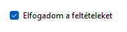

**Mi ez?** Pipálható négyzet – igen/nem érték. Több is bepipálható egyszerre.
**Mire jó:** szűrők („csak vegetáriánus”, „csak csípős”), „Elfogadom”.
**Fontos tulajdonságok:** `Checked` (`true`/`false`), `Text`.
**Fő esemény:** `CheckedChanged`.
```csharp
checkBox1.CheckedChanged += (s, e) => Szures();
if (checkBox1.Checked) { ... }
```

### CheckedListBox – pipálható lista
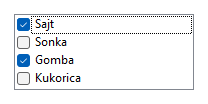

**Mi ez?** Lista, amelynek minden sora előtt jelölőnégyzet van.
**Mire jó:** több elem kiválasztása (pl. feltétek, kategóriák).
**Fontos:** `Items`, `CheckedItems` (a bepipáltak), `SetItemChecked(index, true)`.
**Fő esemény:** `ItemCheck`, `SelectedIndexChanged`.
```csharp
checkedListBox1.Items.AddRange(new object[] { "Sajt", "Sonka", "Gomba" });
foreach (var elem in checkedListBox1.CheckedItems) { ... }
```

### ComboBox – legördülő lista ⭐
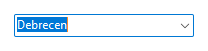

**Mi ez?** Lenyíló lista; egy elem választható (és – alapból – gépelni is lehet bele).
**Mire jó:** város / fajta / kategória kiválasztása, ami alapján szűrsz.
**Fontos:** `Items`, `SelectedIndex` (-1 = nincs), `SelectedItem`, `Text`, `DropDownStyle = DropDownList` (csak választani lehessen, gépelni ne).
**Fő esemény:** `SelectedIndexChanged`.
```csharp
foreach (var fajta in kutyak.Select(x => x.Fajta).Distinct()) comboBox1.Items.Add(fajta);
comboBox1.SelectedIndexChanged += (s, e) => { string valasztott = comboBox1.SelectedItem!.ToString()!; ... };
```

### DateTimePicker – dátumválasztó
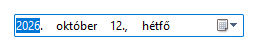

**Mi ez?** Dátum (és idő) kiválasztása lenyíló naptárral.
**Mire jó:** születési dátum, foglalás napja.
**Fontos:** `Value` (`DateTime`), `Format` (`Short`, `Long`, `Custom` + `CustomFormat = "yyyy.MM.dd"`), `MinDate`, `MaxDate`.
**Fő esemény:** `ValueChanged`.
```csharp
DateTime datum = dateTimePicker1.Value;
int kor = DateTime.Now.Year - dateTimePicker1.Value.Year;
```

### Label – felirat ⭐
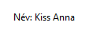

**Mi ez?** Szöveg kiírása a formra. A felhasználó nem tudja szerkeszteni.
**Mire jó:** mezőnevek („Név:”), eredmények kiírása („Átlag: 4,5”), címsor.
**Fontos:** `Text`, `Font`, `ForeColor`, `AutoSize` (méret igazodjon a szöveghez).
```csharp
label1.Text = $"Átlagár: {laptops.Average(x => x.Price):F2} Ft";
label1.ForeColor = Color.Red;
```

### LinkLabel – link felirat
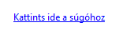

**Mi ez?** Kattintható, aláhúzott, kék szöveg – mint egy weboldalon a link.
**Fontos:** `Text`, `LinkColor`, `LinkVisited`.
**Fő esemény:** `LinkClicked`.
```csharp
linkLabel1.LinkClicked += (s, e) =>
    System.Diagnostics.Process.Start(new System.Diagnostics.ProcessStartInfo("https://example.com") { UseShellExecute = true });
```

### ListBox – lista ⭐


**Mi ez?** Sorok listája; egy (vagy több) sor kijelölhető.
**Mire jó:** **a leggyakoribb**: a fájlból beolvasott elemek listája; kattintásra a kiválasztott adatai megjelennek.
**Fontos:** `Items` (`Add`, `Clear`, `Count`), `SelectedIndex` (-1 = nincs), `SelectedItem`, `SelectionMode`.
**Fő esemény:** `SelectedIndexChanged`.
```csharp
foreach (var k in kutyak) listBox1.Items.Add(k.Nev);
listBox1.SelectedIndexChanged += (s, e) =>
{
    int i = listBox1.SelectedIndex;
    if (i == -1) return;
    nevLabel.Text = kutyak[i].Nev;
};
```

### ListView – lista oszlopokkal
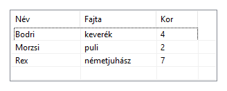

**Mi ez?** Lista nézet; `View = Details` módban **oszlopos táblázat** (mint a Windows Intéző részletes nézete).
**Fontos:** `View` (`Details`, `List`, `LargeIcon`…), `Columns`, `Items`, `FullRowSelect`, `GridLines`, `SelectedItems`.
**Fő esemény:** `SelectedIndexChanged`.
```csharp
listView1.View = View.Details;
listView1.Columns.Add("Név", 100); listView1.Columns.Add("Fajta", 110);
listView1.Items.Add(new ListViewItem(new[] { "Bodri", "keverék" }));
```

### MaskedTextBox – maszkolt szövegmező
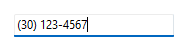

**Mi ez?** Olyan TextBox, ami csak a megadott formátumot engedi (pl. telefonszám, irányítószám).
**Fontos:** `Mask` (`0` = kötelező számjegy, `9` = nem kötelező számjegy, `L` = betű), `MaskCompleted` (ki van-e töltve teljesen).
```csharp
maskedTextBox1.Mask = "(99) 000-0000";
if (!maskedTextBox1.MaskCompleted) MessageBox.Show("Hiányos telefonszám!");
```

### MonthCalendar – naptár
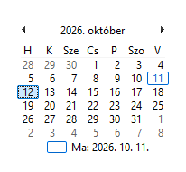

**Mi ez?** Mindig látható havi naptár, dátum(tartomány) kiválasztására.
**Fontos:** `SelectionStart`, `SelectionEnd`, `MaxSelectionCount`, `SetDate(...)`.
**Fő esemény:** `DateSelected`, `DateChanged`.
```csharp
monthCalendar1.DateSelected += (s, e) => label1.Text = e.Start.ToShortDateString();
```

### NotifyIcon – ikon a tálcán
*Nincs kép: nem a formon jelenik meg, hanem a Windows tálca jobb alsó sarkában (az óra mellett).*

**Mi ez?** Ikon a tálca értesítési területén, buborék-üzenettel. A tervező alsó sávjába kerül.
**Fontos:** `Icon` (kötelező, különben nem látszik), `Text`, `Visible`, `ShowBalloonTip(...)`.
```csharp
notifyIcon1.Icon = SystemIcons.Information;
notifyIcon1.Visible = true;
notifyIcon1.ShowBalloonTip(3000, "Kész", "A mentés sikerült.", ToolTipIcon.Info);
```

### NumericUpDown – számléptető ⭐
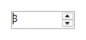

**Mi ez?** Számbeviteli mező fel/le nyilakkal. Csak számot enged.
**Mire jó:** darabszám, érmek száma, életkor.
**Fontos:** `Value` (**`decimal`** típus!), `Minimum`, `Maximum`, `Increment`, `DecimalPlaces`.
**Fő esemény:** `ValueChanged`.
```csharp
int db = (int)numericUpDown1.Value;      // decimal → int átalakítás kell!
numericUpDown1.Value = orszag.Arany;
```

### PictureBox – kép
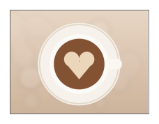

**Mi ez?** Kép megjelenítése.
**Fontos:** `Image`, `ImageLocation` (fájl útvonala), `SizeMode` (**`Zoom`** = arányosan kitölt, `StretchImage` = torzítva kitölt, `Normal`).
```csharp
pictureBox1.SizeMode = PictureBoxSizeMode.Zoom;
pictureBox1.Image = Image.FromFile("../../../kepek/kutya.jpg");
```

### ProgressBar – folyamatjelző


**Mi ez?** Csík, ami egy folyamat (vagy arány) előrehaladását mutatja.
**Fontos:** `Value`, `Minimum`, `Maximum` (alap 0–100), `Style` (`Marquee` = végtelen animáció).
```csharp
progressBar1.Maximum = laptops.Count;
progressBar1.Value = laptops.Count(x => x.Storage.Contains("SSD"));   // pl. arány szemléltetése
```

### RadioButton – választógomb ⭐


**Mi ez?** Kör alakú választó; **egy csoportban egyszerre csak egy** lehet bejelölve. A csoport = ugyanabban a tárolóban (**GroupBox** / **Panel**) lévők.
**Mire jó:** fizetési mód, ajtók száma, nem.
**Fontos:** `Checked`, `Text`.
**Fő esemény:** `CheckedChanged`.
```csharp
int ajtok = 0;
if (radioButton1.Checked) ajtok = 2;
else if (radioButton2.Checked) ajtok = 4;
```

### RichTextBox – formázott, többsoros szövegdoboz ⭐
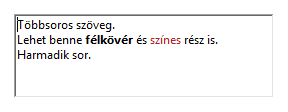

**Mi ez?** Többsoros szövegdoboz, amiben lehet félkövér, színes rész is.
**Mire jó:** egy elem **részletes adatainak** kiírása több sorban; kosár tartalma.
**Fontos:** `Text`, `ReadOnly`, `AppendText(...)`, `Clear()`, formázáshoz `Select(...)` + `SelectionFont`/`SelectionColor`.
```csharp
richTextBox1.Text = $"Kategória\n\t{l.Category}\nÁr\n\t{l.Price} Ft";
richTextBox1.AppendText("új sor\n");
```

### TextBox – szövegmező ⭐


**Mi ez?** Egysoros (vagy `Multiline = true` esetén többsoros) szövegbevitel.
**Mire jó:** keresőmező, név, darabszám bekérése.
**Fontos:** `Text`, `ReadOnly`, `Multiline`, `PlaceholderText` (halvány súgószöveg), `MaxLength`, `UseSystemPasswordChar` (jelszó).
**Fő esemény:** `TextChanged` (minden betűnél – kereséshez!).
```csharp
textBox1.TextChanged += (s, e) =>
{
    var talalat = varak.Where(x => x.Nev.ToLower().Contains(textBox1.Text.ToLower()));
    ...
};
if (!int.TryParse(textBox1.Text, out int db)) MessageBox.Show("Számot adj meg!");
```

### ToolTip – súgóbuborék
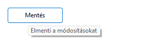

**Mi ez?** Kis buborék, ami akkor jelenik meg, ha az egeret egy vezérlő fölé viszed. A tervező alsó sávjába kerül; felrakása után **minden vezérlőnek** lesz egy új „ToolTip on toolTip1” tulajdonsága.
```csharp
toolTip1.SetToolTip(button1, "Elmenti a módosításokat");
```

### TreeView – fa nézet
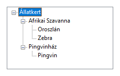

**Mi ez?** Kinyitható-becsukható, faszerkezetű lista (mint az Intéző bal oldala).
**Fontos:** `Nodes` (`Add`), `SelectedNode`, `ExpandAll()`.
**Fő esemény:** `AfterSelect`.
```csharp
var reszleg = treeView1.Nodes.Add("Afrikai Szavanna");
reszleg.Nodes.Add("Oroszlán");
treeView1.AfterSelect += (s, e) => label1.Text = e.Node!.Text;
```

### WebBrowser – böngésző a formon
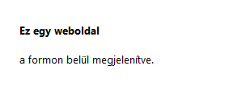

**Mi ez?** Weboldal vagy HTML megjelenítése a formon belül (régi, Internet Explorer motor).
**Fontos:** `Url`, `DocumentText`, `Navigate(...)`.
```csharp
webBrowser1.DocumentText = "<h3>Helló</h3><p>HTML a formon</p>";
```

---

## Containers – tárolók

Tárolók = más vezérlőket tartalmazó dobozok. Ha a tárolót mozgatod, a benne lévők vele mennek.

### FlowLayoutPanel – folyó elrendezés
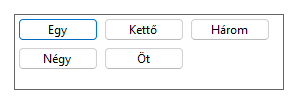

**Mi ez?** A beletett vezérlőket **magától sorba rendezi** (egymás mellé, ha nem fér: új sorba).
**Mire jó:** dinamikusan létrehozott gombok/kártyák elhelyezése.
**Fontos:** `FlowDirection`, `WrapContents`, `AutoScroll`.
```csharp
foreach (var p in pizzak) flowLayoutPanel1.Controls.Add(new Button { Text = p.Nev, Width = 100 });
```

### GroupBox – csoportkeret ⭐


**Mi ez?** Keret felirattal, ami összefogja a vezérlőket. **A benne lévő RadioButtonok egy csoportot alkotnak.**
**Fontos:** `Text` (a keret felirata), `Controls`.
```csharp
var valasztott = groupBox1.Controls.OfType<RadioButton>().FirstOrDefault(r => r.Checked);
```

### Panel – panel
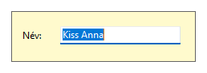

**Mi ez?** Felirat nélküli doboz vezérlők csoportosítására (pl. egyszerre elrejteni őket).
**Fontos:** `BorderStyle`, `BackColor`, `Visible`, `AutoScroll`.
```csharp
panel1.Visible = false;     // a benne lévő összes vezérlő eltűnik
```

### SplitContainer – osztott tároló
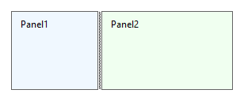

**Mi ez?** Két panel (`Panel1`, `Panel2`) egy **húzható elválasztóval** – pl. bal oldalt lista, jobb oldalt részletek.
**Fontos:** `Orientation` (`Vertical` / `Horizontal`), `SplitterDistance`, `Panel1`, `Panel2`.

### TabControl – fülek
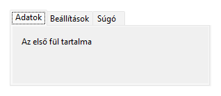

**Mi ez?** Füles lapok; minden fül (`TabPage`) külön tartalmat mutat.
**Fontos:** `TabPages`, `SelectedIndex`, `SelectedTab`. Új fül tervezőben: jobb klikk → *Add Tab*, vagy a `TabPages` tulajdonságnál.
**Fő esemény:** `SelectedIndexChanged`.
```csharp
tabControl1.SelectedIndex = 1;    // a 2. fülre vált
```

### TableLayoutPanel – táblázatos elrendezés
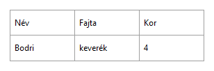

**Mi ez?** Rács (sorok × oszlopok); minden cellába egy vezérlő kerül. Átméretezéskor arányosan igazodik.
**Fontos:** `ColumnCount`, `RowCount`, `ColumnStyles`/`RowStyles` (százalék vagy pixel), `CellBorderStyle`.

---

## Menus & Toolbars – menük és eszköztárak

### ContextMenuStrip – jobb klikkes menü
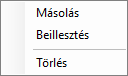

**Mi ez?** Jobb egérgombra felugró menü. A tervező alsó sávjába kerül; egy vezérlő `ContextMenuStrip` tulajdonságához rendeled.
```csharp
listBox1.ContextMenuStrip = contextMenuStrip1;
torlesToolStripMenuItem.Click += (s, e) => { ... };    // a menüpont kattintása
```

### MenuStrip – menüsor
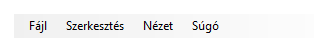

**Mi ez?** A form tetején lévő menüsor (Fájl, Szerkesztés, Súgó…). Tervezőben a „Type Here” helyre írod a menüpontokat.
**Fő esemény:** minden menüpont (`ToolStripMenuItem`) `Click`-je.
```csharp
kilepesToolStripMenuItem.Click += (s, e) => Application.Exit();
```
Tipp: `&Fájl` → az **F** aláhúzva, **Alt+F**-fel nyílik.

### StatusStrip – állapotsor
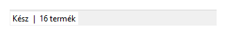

**Mi ez?** Sáv a form **alján**, állapot kiírására („Kész”, „16 termék”).
**Fontos:** `Items` – leggyakrabban `ToolStripStatusLabel`.
```csharp
toolStripStatusLabel1.Text = $"{listBox1.Items.Count} elem";
```

### ToolStrip – eszköztár
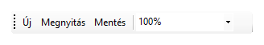

**Mi ez?** Gombsor a menü alatt (Új, Megnyitás, Mentés…), lehet benne lenyíló lista, szövegmező is.
**Fontos:** `Items` (`ToolStripButton`, `ToolStripComboBox`, `ToolStripSeparator`…), gomboknál `DisplayStyle` (`Text`, `Image`, `ImageAndText`).

### ToolStripContainer – eszköztár-tároló
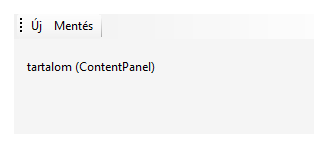

**Mi ez?** Tároló, aminek mind a 4 szélére eszköztár húzható (a felhasználó át is rendezheti), középen a tartalom (`ContentPanel`).

---

## Data – adatok

### BindingNavigator – léptető sáv
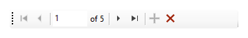

**Mi ez?** Kész eszköztár rekordok közti lépkedéshez (első, előző, „1 of 5”, következő, utolsó, új, törlés). Egy `BindingSource`-hoz kötöd.
```csharp
bindingSource1.DataSource = kutyak;
bindingNavigator1.BindingSource = bindingSource1;
```

### BindingSource – adatkötés-forrás
*Nincs kép: nem látható komponens (a tervező alsó sávjába kerül).*

**Mi ez?** „Közvetítő” egy lista és a vezérlők között: ha rákötöd a listádat, a vezérlők (DataGridView, TextBox, BindingNavigator) automatikusan együtt mozognak.
```csharp
bindingSource1.DataSource = kutyak;
dataGridView1.DataSource = bindingSource1;
textBox1.DataBindings.Add("Text", bindingSource1, "Nev");    // a TextBox mindig az aktuális kutya nevét mutatja
```

### DataGridView – táblázat ⭐
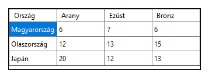

**Mi ez?** Szerkeszthető táblázat sorokkal és oszlopokkal.
**Mire jó:** éremtábla, várak, fesztiválok listája; sorra kattintva részletek.
**Fontos:** `Columns` (tervezőben: jobb felső kis nyíl → *Edit Columns*), `Rows.Add(...)`, `Rows.Clear()`, `DataSource`, `AllowUserToAddRows = false` (ne legyen üres sor alul), `ReadOnly`, `SelectionMode = FullRowSelect`, `RowHeadersVisible = false`, `AutoSizeColumnsMode = Fill`.
**Fő esemény:** `CellClick` (vigyázz: fejlécre kattintva `e.RowIndex == -1`!).
```csharp
foreach (var o in orszagok) dataGridView1.Rows.Add(o.Nev, o.Arany, o.Ezust, o.Bronz);

dataGridView1.CellClick += (s, e) =>
{
    if (e.RowIndex < 0) return;
    string nev = dataGridView1.Rows[e.RowIndex].Cells[0].Value!.ToString()!;
};
// vagy egyszerűen: dataGridView1.DataSource = orszagok;   (oszlopok a property-kből)
```

### DataSet – memóriabeli adatbázis
*Nincs kép: nem látható komponens.*

**Mi ez?** Táblákat (`DataTable`) tartalmazó, memóriában lévő „mini adatbázis”. Régebbi adatkezelési mód; általában a `List<T>` + LINQ az egyszerűbb.
```csharp
var tabla = new DataTable();
tabla.Columns.Add("Név"); tabla.Columns.Add("Kor", typeof(int));
tabla.Rows.Add("Bodri", 4);
dataGridView1.DataSource = tabla;
```

> A **Chart** (diagram) vezérlő csak a régi *.NET Framework*-ös WinForms-ban van a Toolboxban, a mostani .NET-esben nincs.

---

## Components – komponensek

Ezek **nem látszanak a formon** – a tervező alján lévő szürke sávba kerülnek, és kódból használod őket. (Kivétel: az ErrorProvider ikonja.)

### BackgroundWorker – háttérmunka
**Mi ez?** Hosszú művelet futtatása a háttérben, hogy közben ne fagyjon le az ablak.
**Fontos események:** `DoWork` (a háttérmunka), `ProgressChanged`, `RunWorkerCompleted`; indítás: `RunWorkerAsync()`.
```csharp
backgroundWorker1.DoWork += (s, e) => { /* hosszú számolás */ };
backgroundWorker1.RunWorkerCompleted += (s, e) => label1.Text = "Kész!";
backgroundWorker1.RunWorkerAsync();
```

### ErrorProvider – hibajelző ikon
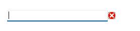

**Mi ez?** Piros felkiáltójel egy vezérlő mellett, ha hibás az adat; fölé víve megjelenik az üzenet.
```csharp
if (string.IsNullOrWhiteSpace(textBox1.Text))
    errorProvider1.SetError(textBox1, "Kötelező mező!");
else
    errorProvider1.SetError(textBox1, "");          // hiba törlése
```

### EventLog – Windows eseménynapló
**Mi ez?** Bejegyzés írása/olvasása a Windows eseménynaplójába. Ritkán kell.
```csharp
eventLog1.Source = "Application";
eventLog1.WriteEntry("A program elindult.");
```

### FileSystemWatcher – mappafigyelő
**Mi ez?** Figyel egy mappát, és eseményt küld, ha benne fájl jön létre / változik / törlődik.
**Fontos:** `Path`, `Filter` (pl. `*.txt`), `EnableRaisingEvents = true`; események: `Created`, `Changed`, `Deleted`, `Renamed`.

### HelpProvider – súgó (F1)
**Mi ez?** Ha a felhasználó egy vezérlőn állva **F1**-et nyom, megjelenik hozzá egy súgószöveg.
```csharp
helpProvider1.SetHelpString(textBox1, "Ide a teljes nevet írd.");
helpProvider1.SetShowHelp(textBox1, true);
```

### ImageList – képlista
**Mi ez?** Képek gyűjteménye, amit más vezérlők (ListView, TreeView, TabControl, Button) indexszel használnak.
**Fontos:** `Images` (tervezőben: *Choose images*), `ImageSize`.
```csharp
listView1.SmallImageList = imageList1;
listView1.Items.Add("Bodri", 0);    // a 0. kép az ikonja
```

### Process – folyamat indítása
**Mi ez?** Másik program vagy fájl/weblap megnyitása.
```csharp
System.Diagnostics.Process.Start(new System.Diagnostics.ProcessStartInfo("notepad.exe", "../../../forras/ki.txt") { UseShellExecute = true });
```

### SerialPort – soros port
**Mi ez?** Kommunikáció soros (COM) porton keresztül (pl. Arduino). Ritkán kell.
**Fontos:** `PortName` (pl. `COM3`), `BaudRate`, `Open()`, `WriteLine(...)`, `ReadLine()`; esemény: `DataReceived`.

### ServiceController – Windows-szolgáltatás kezelése
**Mi ez?** Windows-szolgáltatás állapotának lekérdezése, indítása, leállítása. Ritkán kell.
**Fontos:** `ServiceName`, `Status`, `Start()`, `Stop()`.

### Timer – időzítő
**Mi ez?** Megadott időközönként (`Interval`, **ezredmásodpercben**) lefuttat egy eseményt.
**Mire jó:** óra a formon, visszaszámláló, animáció.
**Fontos:** `Interval` (1000 = 1 mp), `Enabled` / `Start()` / `Stop()`.
**Fő esemény:** `Tick`.
```csharp
timer1.Interval = 1000;
timer1.Tick += (s, e) => label1.Text = DateTime.Now.ToString("HH:mm:ss");
timer1.Start();
```

---

## Printing – nyomtatás

### PageSetupDialog – oldalbeállítás
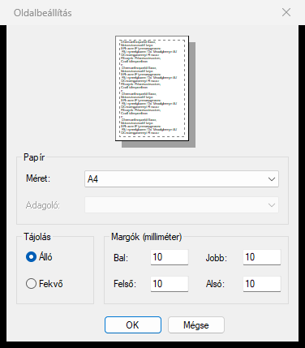

**Mi ez?** Papírméret, tájolás, margók beállítása. A `Document` tulajdonságába a `PrintDocument` kell.
```csharp
pageSetupDialog1.Document = printDocument1;
pageSetupDialog1.ShowDialog();
```

### PrintDialog – nyomtatás ablak
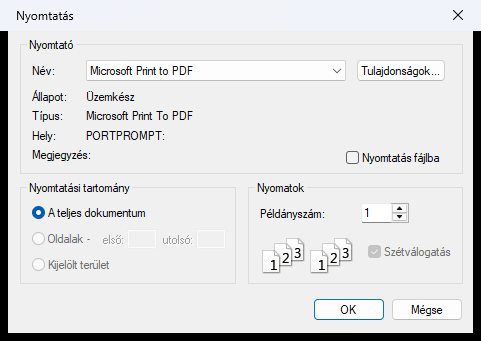

**Mi ez?** A szokásos „Nyomtatás” ablak: nyomtató, példányszám, oldalak.
```csharp
printDialog1.Document = printDocument1;
if (printDialog1.ShowDialog() == DialogResult.OK) printDocument1.Print();
```

### PrintDocument – a nyomtatandó dokumentum
*Nincs kép: nem látható komponens – ez „rajzolja meg” az oldalt.*

**Mi ez?** A nyomtatás „motorja”: a `PrintPage` eseményében rajzolod meg, mi kerüljön a papírra.
```csharp
printDocument1.PrintPage += (s, e) =>
{
    e.Graphics!.DrawString("Babszem Kávézó – számla", new Font("Segoe UI", 20), Brushes.Black, 80, 80);
};
printDocument1.Print();     // nyomtatás (a PrintDialog/PrintPreview is ezt használja)
```

### PrintPreviewControl – nyomtatási kép a formon
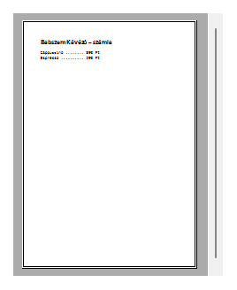

**Mi ez?** A formon belül mutatja meg, hogyan nézne ki a nyomtatás.
**Fontos:** `Document`, `Zoom`.

### PrintPreviewDialog – nyomtatási kép ablak
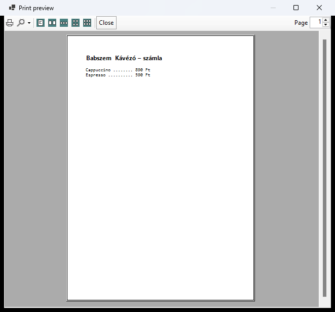

**Mi ez?** Kész ablak nyomtatási képpel (nagyítás, oldalak, nyomtatás gomb).
```csharp
printPreviewDialog1.Document = printDocument1;
printPreviewDialog1.ShowDialog();
```

---

## Dialogs – párbeszédablakok

Mindegyik a tervező alsó sávjába kerül, és a **`ShowDialog()`** nyitja meg. Ha a felhasználó az OK/Megnyitás/Mentés gombot nyomta: `== DialogResult.OK`.

### ColorDialog – színválasztó
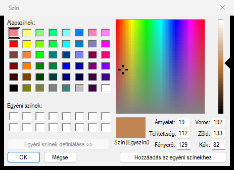

```csharp
if (colorDialog1.ShowDialog() == DialogResult.OK)
    this.BackColor = colorDialog1.Color;
```
**Fontos:** `Color` (a kiválasztott szín), `FullOpen` (egyéni színek része is nyitva).

### FolderBrowserDialog – mappaválasztó
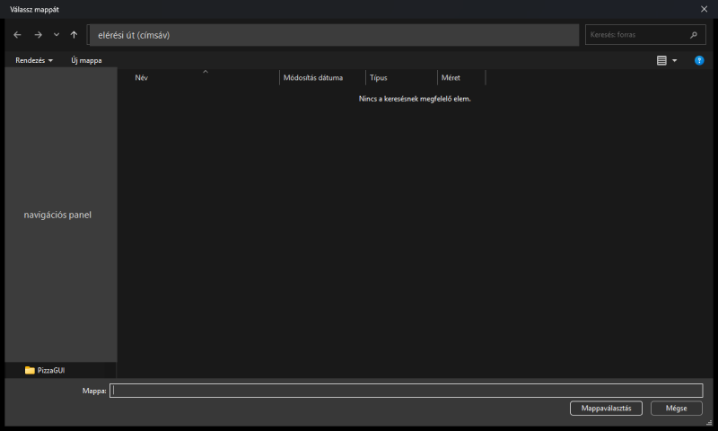

```csharp
if (folderBrowserDialog1.ShowDialog() == DialogResult.OK)
    label1.Text = folderBrowserDialog1.SelectedPath;
```
**Fontos:** `SelectedPath`, `Description`, `InitialDirectory`.

### FontDialog – betűtípus-választó
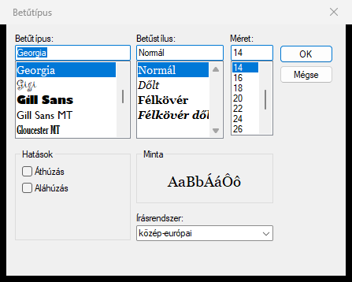

```csharp
if (fontDialog1.ShowDialog() == DialogResult.OK)
    label1.Font = fontDialog1.Font;
```
**Fontos:** `Font`, `ShowColor` + `Color` (betűszín is választható).

### OpenFileDialog – fájl megnyitása
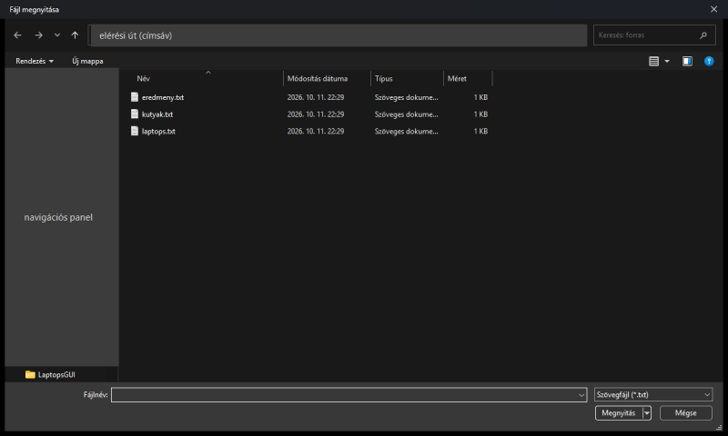

*(A képen a bal oldali panelt és a címsávot letakartam.)*

```csharp
openFileDialog1.Filter = "Szövegfájl|*.txt|Minden fájl|*.*";
if (openFileDialog1.ShowDialog() == DialogResult.OK)
{
    foreach (var sor in File.ReadAllLines(openFileDialog1.FileName).Skip(1))
        kutyak.Add(new Kutya(sor));
}
```
**Fontos:** `FileName` (a kiválasztott fájl teljes útvonala), `Filter`, `InitialDirectory`, `Title`, `Multiselect`.

### SaveFileDialog – mentés másként
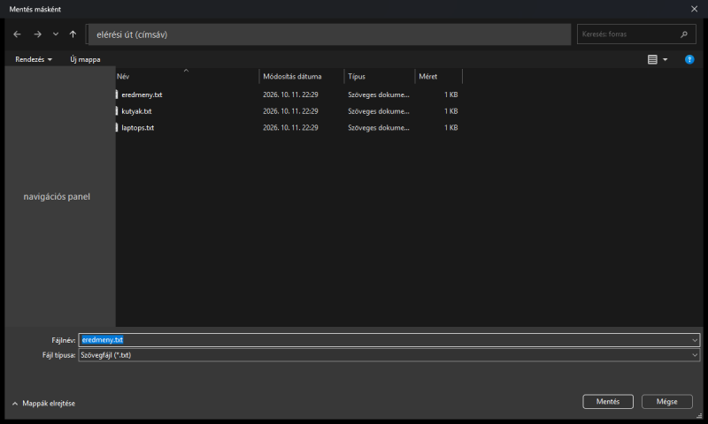

```csharp
saveFileDialog1.Filter = "Szövegfájl|*.txt";
saveFileDialog1.FileName = "eredmeny.txt";
if (saveFileDialog1.ShowDialog() == DialogResult.OK)
{
    using var iro = new StreamWriter(saveFileDialog1.FileName);
    foreach (var k in kutyak) iro.WriteLine($"{k.Nev};{k.Fajta}");
}
```
**Fontos:** `FileName`, `Filter`, `DefaultExt`, `OverwritePrompt`.

---

## WPF Interoperability

### ElementHost – WPF-vezérlő a formon
*Nincs kép: egy üres keret, amibe WPF-es vezérlőt lehet tenni.*

**Mi ez?** Lehetővé teszi, hogy egy WinForms ablakban **WPF**-ben írt vezérlő jelenjen meg. Ritkán kell.
**Fontos:** `Child` (a WPF-vezérlő).

---

## All Windows Forms – további elemek

Ezek csak az **„All Windows Forms”** kategóriában vannak (a Toolbox tetején, minden elem egy listában).

### DomainUpDown – szöveges léptető
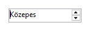

**Mi ez?** Mint a NumericUpDown, de **szöveges** elemek között lépked (pl. Kicsi / Közepes / Nagy).
**Fontos:** `Items`, `SelectedIndex`, `SelectedItem`, `Text`.
**Fő esemény:** `SelectedItemChanged`.

### HScrollBar – vízszintes görgetősáv


**Mi ez?** Önálló vízszintes görgetősáv (Windows 11-en vékony, egér fölé víve vastagodik). Értéket lehet vele állítani.
**Fontos:** `Value`, `Minimum`, `Maximum`, `SmallChange`, `LargeChange`.
**Fő esemény:** `Scroll`, `ValueChanged`.

### VScrollBar – függőleges görgetősáv


**Mi ez?** Ugyanaz függőlegesen.

### TrackBar – csúszka
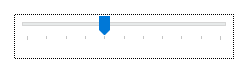

**Mi ez?** Csúszka egy érték beállítására (pl. hangerő, értékelés 1–10).
**Fontos:** `Value`, `Minimum`, `Maximum`, `TickFrequency`.
**Fő esemény:** `Scroll`, `ValueChanged`.
```csharp
trackBar1.ValueChanged += (s, e) => label1.Text = $"Értékelés: {trackBar1.Value}";
```

### PropertyGrid – tulajdonságrács
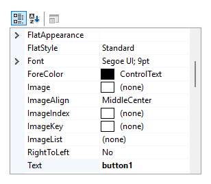

**Mi ez?** Ugyanolyan táblázat, mint a Visual Studio *Properties* ablaka – egy objektum összes tulajdonságát mutatja és szerkeszti.
```csharp
propertyGrid1.SelectedObject = kutyak[0];     // a kutya összes property-je szerkeszthető
```

### Splitter – elválasztó (régi)
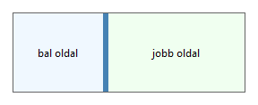

**Mi ez?** Húzható elválasztó két dokkolt vezérlő között. Régi megoldás – helyette a **SplitContainer** ajánlott.

---

## MessageBox (nincs a Toolboxban)

A `MessageBox` nem Toolbox-elem, hanem **kódból** hívod – de szinte minden GUI-feladatban kell.

**Egyszerű üzenet:**

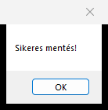

```csharp
MessageBox.Show("Sikeres mentés!");
```

**Kérdés Igen / Nem gombbal:**

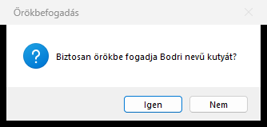

```csharp
DialogResult valasz = MessageBox.Show(
    "Biztosan örökbe fogadja Bodri nevű kutyát?",   // szöveg
    "Örökbefogadás",                                  // címsor
    MessageBoxButtons.YesNo,                          // gombok
    MessageBoxIcon.Question);                         // ikon

if (valasz == DialogResult.Yes)
{
    // ... mentés, kilépés stb.
}
```
**Gombok:** `OK`, `OKCancel`, `YesNo`, `YesNoCancel`, `RetryCancel`, `AbortRetryIgnore`.
**Ikonok:** `Information`, `Question`, `Warning`, `Error`, `None`.
**Válaszok:** `DialogResult.OK`, `.Cancel`, `.Yes`, `.No` …
